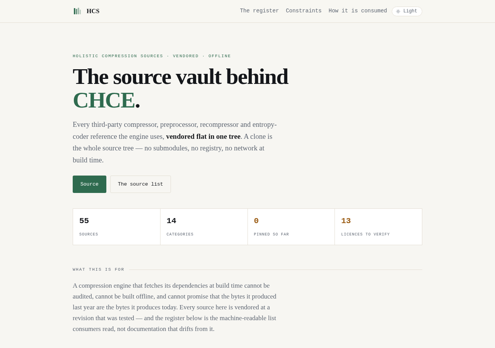

# Holistic Compression Sources (HCS)

[](LICENSE)



Canonical, offline, vendored source vault for the **CHCE** engine
(Chimera Hybrid Compression Engine) and all CHIMERA-family projects
(`heavenzip`, `ziptastic`, `compfactory`).

Every third-party compressor, preprocessor, recompressor, and
entropy-coder reference used by CHCE lives in [`/old`](./old), pinned at a
known-good revision. Consumers pull this repo with `git subtree` and build
from the pinned tree.

**Design constraints (non-negotiable):**

1. **Offline-only.** No neural networks, no model files, no GPU runtimes.
   Context-mixing (CM) compressors like `zpaq`, `paq8px`, `lpaq` are pure
   algorithms — they are **not AI** and are fully offline.
2. **Single source of truth.** One copy of each source, no nested `.git`
   directories. Sources are vendored flat, with one deliberate exception: 23 of
   them are **git submodules** pinned to an upstream commit, because copying
   another project's history would make this vault a fork of it rather than a
   mirror. See [Vendored sources and submodules](#vendored-sources-and-submodules).
3. **License-audited.** Every source is listed with its licence identifier in
   `SOURCES`, and `LICENSES/` carries the texts: the canonical SPDX text for each
   identifier, plus the notice as it actually ships with the source. Every file
   in there records where it came from and its SHA-256 in `LICENSES/INDEX.json`,
   and `tools/check-licences.py` fails the build if a text goes missing or
   changes without the record. One source (`LPAQ9`) is still unresolved and says
   so rather than being assumed licensed.

---

## Integration Model

| Consumer | How it uses HCS |
|---|---|
| `ziptastic` (native engine) | `git subtree` of `HCS` into `vendor/` |
| `heavenzip` (orchestrator) | Consumes **prebuilt binaries** released by `ziptastic` — does not build from `/old` |
| `compfactory` (workshop) | Full checkout; edits propagate back to HCS via PR |

> **Rule:** `heavenzip` must never contain algorithm code; `ziptastic` must
> never shell out to external executables. HCS exists to feed `ziptastic`.

---

## Repository Layout
HCS/
├── README.md # this file
├── SOURCES # machine-readable manifest (id, url, pin, licence, integration)
├── NOTICE # whose work is inside, under what terms, and what is unresolved
├── .gitmodules # URL mapping for the 23 pinned sources
├── LICENSES/ # SPDX texts + per-source notices; INDEX.json records provenance
├── old/ # vendored sources (the vault)
│ ├── xz/
│ ├── zpaq/
│ ├── srep/
│ └── ...
└── (future)
└── chimera/ # optional: CHCE glue code that consumes /old

---

## Source Catalog

Grouped by role in a CHCE pipeline.

### 🧮 Entropy / Final-Stage Coders

| Source | Role | License | Pin |
|---|---|---|---|
| `xz` | LZMA2 reference implementation | 0BSD / LGPL-2.1 | `TBD` |
| `lzma` | LZMA SDK (raw codec) | Public Domain | `TBD` |
| `7z` | 7-Zip SDK — PPMd + LZMA | Public Domain | `TBD` |
| `brotli` | Static dictionary + context-modeled coder | MIT | `TBD` |
| `fse` | FiniteStateEntropy + Huff0 (rANS/Huffman reference) | BSD-3 | `TBD` |
| `ryg_rans` | Minimal rANS reference (Charles Bloom) | Public Domain | `TBD` |

### 🔗 LZ / Match-Finder Backends

| Source | Role | License | Pin |
|---|---|---|---|
| `srep` | Long-range block-hash matcher | Public Domain | `TBD` |
| `zstd` | Speed/ratio spectrum backend | BSD-3 / GPLv2 | `TBD` |
| `lz4` | Fast baseline backend | BSD-2 | `TBD` |
| `lzham` | LZMA-class alternative | MIT | `TBD` |
| `freearc-c` | LZMA, PPMd, Tornado, GRZip bundle | varies | `TBD` |
| `freearc-main` | FreeArc (original) | mixed | `TBD` |
| `FA-master` | FreeArc Next (reference only — incomplete C++) | mixed | `TBD` |

### 🧠 Context-Mixing Backends (Ratio Ceiling — pure algorithm)

| Source | Role | License | Pin |
|---|---|---|---|
| `zpaq` | ZPAQ CM engine (`libzpaq`) | Public Domain | `TBD` |
| `zpaqfranz` | Maintained ZPAQ fork, robust CLI | PD / GPL | `TBD` |
| `paq8px` | Highest-ratio non-neural CM | GPL-2.0 | `TBD` |
| `LPAQ9` | Lightweight PAQ variant | Public Domain | `TBD` |
| `omnizip-zpaq` | Rust CM (`omnizip-rs`) — reference | verify | `TBD` |

### 🔄 BWT Backends

| Source | Role | License | Pin |
|---|---|---|---|
| `libbsc` | BWT + LCP + ANS | Apache-2.0 | `TBD` |
| `bzip3` | Modern BWT successor to bzip2 | Apache-2.0 | `TBD` |

### 🔢 Numeric / Structured Data

| Source | Role | License | Pin |
|---|---|---|---|
| `pcodec` | Quantile-based numeric compressor | Apache-2.0 | `TBD` |
| `bitshuffle` | Bit-transpose for typed arrays | MIT | `TBD` |

### ⚡ Fast / Asymmetric Codecs

| Source | Role | License | Pin |
|---|---|---|---|
| `zxc` | Ultra-fast decode, better than LZ4 | MIT (verify) | `TBD` |
| `density` | Ultra-fast LZ, near-memory-bandwidth decode | BSD-2 | `TBD` |
| `csc` | LZMA-inspired fast LZ codec | MIT (verify) | `TBD` |
| `lizard` | LZ4 fork with moderate-ratio tier | BSD-2 | `TBD` |
| `brieflz` | Tiny LZ77 for constrained targets | zlib | `TBD` |
| `snappy` | Google fast codec (benchmark baseline) | BSD-3 | `TBD` |
| `lzo` | Classic fast codec (kernel/embedded) | GPL / commercial | `TBD` |

### 🧹 Preprocessors

| Source | Role | License | Pin |
|---|---|---|---|
| `parmar` | Subword tokenization for text | verify | `TBD` |
| `shoco` | Short-string compressor | MIT | `TBD` |
| `smaz` | Very-short-string compressor | BSD-3 | `TBD` |

### 🖼️ Recompressors (Format-Aware)

| Source | Role | License | Pin |
|---|---|---|---|
| `preflate` | DEFLATE recompressor (C++) | Apache-2.0 | `TBD` |
| `preflate-rs` | DEFLATE recompressor (Rust) | Apache-2.0 | `TBD` |
| `precomp-cpp` | Legacy Precomp (reference) | Apache-2.0 | `TBD` |
| `packJPG` | JPEG recompressor ⚠ **LGPL-3** | LGPL-3 | `TBD` |
| `aqueous` | Recompression archive (~20 format families) | MIT-0 / PD | `TBD` |
| `rhefo` | MIME-aware file optimizer | MIT | `TBD` |
| `zopfli` | Iterative Deflate optimizer | Apache-2.0 | `TBD` |
| `advancecomp` | Archive recompressor (gzip/PNG/ZIP) | GPL-3 | `TBD` |

### 🧱 Fast Deflate (Encoder Path)

| Source | Role | License | Pin |
|---|---|---|---|
| `zlib-ng` | Fast, standards-compliant Deflate | zlib | `TBD` |
| `libdeflate` | Fast Deflate (encoder + decoder) | MIT | `TBD` |

### 📦 Executable Packers

| Source | Role | License | Pin |
|---|---|---|---|
| `upx` | Classic executable packer | GPL-2.0 | `TBD` |
| `zelf` | Modern ELF packer (x86_64, AArch64) | verify | `TBD` |

### 🪶 Embedded / Low-Memory

| Source | Role | License | Pin |
|---|---|---|---|
| `tamp` | Low-memory DEFLATE-inspired | MIT | `TBD` |
| `heatshrink` | Minimal LZSS for RT/embedded | ISC | `TBD` |

### 📚 Discovery / Reference Lists

| Source | Role | License | Pin |
|---|---|---|---|
| `awesome-compopt` | Compression tool catalog | CC / MIT | `TBD` |
| `awesome-cpp` | C++ library list (compression section) | CC / MIT | `TBD` |

### 🧪 Additional / Experimental

| Source | Notes | License | Pin |
|---|---|---|---|
| `BARF` | Experimental backend | verify | `TBD` |
| `BBB` | Experimental backend | verify | `TBD` |
| `FLZP` | Experimental LZ family | verify | `TBD` |
| `FPAQF2` | PAQ-family derivative | verify | `TBD` |
| `SR3A` | Experimental | verify | `TBD` |

> "verify" = the licence needs confirming against the source's own file before
> integration. `LICENSES/sources/` now holds the notice that ships with each
> source, and `LICENSES/README.md` shows it beside the identifier `SOURCES`
> claims, so confirming means reading one file and recording the result in this
> table — see [Known gaps](#known-gaps). `TBD` in the pin column is replaced by a
> commit SHA the first time the source is built against.

---

## ⚠️ License Warnings

- **`packJPG` is LGPL-3.** If CHCE is closed-source, do **not link** it.
  Treat it as an **external process** invoked by `heavenzip`, or drop JPEG
  recompression for now.
- **`advancecomp` is GPL-3.** Same rule: external process, not linked.
- **`upx` is GPL-2.0.** Same rule.
- **`lzo` is GPL / commercial dual.** Do not link unless CHCE is GPL.
- **`paq8px` is GPL-2.0.** Treat as an **external process** in
  `heavenzip` for the `--max-ratio` tier, not a linked library.

All other listed sources are permissive (MIT, BSD, Apache-2.0, zlib, PD,
0BSD) and safe to link into a closed-source CHCE core.

---

## 🏆 The Offline Ratio Ladder

CHCE selects a tier per block based on the joint parser's cost model.
This is the target performance envelope across the sources in `/old`:

| Tier | Backend(s) | Ratio vs xz | Speed vs xz |
|---|---|---|---|
| **Max ratio** | `paq8px` / `LPAQ9` | 0.70–0.80× | 0.001× |
| **High ratio** | `zpaqfranz -m5` / `zpaq` | 0.80–0.85× | 0.01× |
| **Strong** | `bzip3` / `libbsc` / PPMd (`7z`) | 0.90–0.98× | 0.5–2× |
| **Baseline** | `xz` (LZMA2) | 1.00× | 1.00× |
| **Balanced** | `zxc` / `zstd -19` / `brotli -q11` | 1.05–1.15× | 3–10× |
| **Fast** | `density` / `lz4` / `csc` / `lizard` | 1.3–1.5× | 20–50× |
| **Ultra-fast** | `heatshrink` / `brieflz` / `snappy` | 2× | 100×+ |

Plus these orthogonal transforms that operate **before** the entropy tier:

- **Semantic recompression** — `preflate`, `preflate-rs`, `precomp-cpp`,
  `aqueous`, `rhefo` (DEFLATE, JPEG, PNG, PDF, PE, SQLite, ~20 formats)
- **Text tokenization** — `parmar` (+7–9.6 % on LZMA2 over raw text)
- **Numeric bit-transpose** — `bitshuffle`, `pcodec` (2–10× on typed arrays)
- **Short-string coding** — `shoco`, `smaz`
- **Long-range dedup** — `srep` (matches beyond LZMA's 64 MB window)
- **Executable packing** — `upx`, `zelf`

---

## Bumping a Source

1. `cd old/<source>` and check out the desired revision.
2. Update the `pin` in `SOURCES`.
3. Confirm the licence from the source's own `LICENSE`/`COPYING` file and correct
   the `SOURCES` row if it moved. Then regenerate the licence record:
   `python3 tools/build-licences.py && python3 tools/check-licences.py`. The
   checker fails if a source in `SOURCES` has no entry in `LICENSES/INDEX.json`,
   so a bump that changes the licence cannot pass silently.
4. Regenerate any integration tests in `ziptastic` that consume this source.
5. Open a PR titled `bump: <source> → <new-sha>`.

---

## Adding a New Source

1. `git clone --depth=1 <url> old/<id>` **inside this repo**.
2. `rm -rf old/<id>/.git` — **critical, do not skip**.
3. Add a row to `SOURCES`.
4. Record the licence identifier in the `SOURCES` row. Full licence texts are
   not collected yet — see [Known gaps](#known-gaps).
5. Add a row to the appropriate section of this README.
6. Commit: `add: <id> (<role>)`.

---

## Quick Verification

To check that `/old` contains no nested `.git` folders (the most common
mistake when vendoring):

```bash
find old -name .git -type d
# should print nothing
```

(The 23 pinned submodules are the exception and are expected to carry `.git`;
the check above is about *copied* sources.) The equivalent for the pins is
`./scripts/check-vendor.sh`, below.

## Vendored sources and submodules

Most of `old/` is plain vendored source. 23 entries are **git submodules** — they
pin one commit of an upstream repository rather than copying its history, so the
mirror stays a mirror and HCS never claims authorship of code it did not write.

```bash
git clone --recurse-submodules https://github.com/drsamonline/HCS
# or, in an existing clone:
git submodule update --init --recursive
```

**Verify at any time:**

```bash
./scripts/check-vendor.sh          # exit 0 = every source present and mapped
python3 tools/check-sources.py     # exit 0 = every directory recorded, every id resolves
```

The second one exists because the first never reads `SOURCES`. A directory can
materialise and still have no recorded upstream, licence or integration, and an
id can point at a directory name the vault does not use (`xz` for `xz-master`).
`tools/check-sources.py` reads both sides and says which rows and which
directories disagree. It runs in CI, advisory until the findings it currently
reports are settled.

### Why the guard exists

Until this was fixed, `old/` carried those 23 gitlinks with **no `.gitmodules`
file at all**. That state is unrecoverable: git records a commit SHA for each
submodule but has nowhere to fetch it from, so `git submodule update --init`
could not work, and every clone — HCS, and every repo that vendors a copy of it —
silently got 23 empty directories. Nothing failed until a build or a benchmark
reached for one of them, and then it looked like a missing source rather than a
broken mirror.

The repair was to add the URL mapping that was always missing (the recorded pins
were all valid — 20 resolve by ref, and the remaining 3 fetch fine by SHA). The
guard is the part that makes it not happen again: `scripts/check-vendor.sh` fails
if any directory under `old/` is empty, if a gitlink has no `.gitmodules` entry,
or if a `.gitmodules` entry points at a directory that does not exist. CI runs it
on every push with `submodules: recursive`, so a mirror that cannot materialise
goes red instead of going quiet.

## Known gaps

- **Every vendored source has a licence text.** 52 of 52 carry evidence in
  `LICENSES/`: the canonical SPDX text plus the notice as it ships, with
  provenance and a SHA-256 per file in `INDEX.json`, re-checked on every push by
  `tools/check-licences.py`. `LPAQ9` is recorded from the owner's statement rather
  than from a text, and says so. One source, `rhefo`, is under the SSPL — not an
  open-source licence — and `NOTICE` warns about it.

- **`MANIFEST.json`** records a producer and class per file for the files it
  knows about, and was last written on 2026-11-04. It is not regenerated on
  every push, so treat it as a snapshot rather than an index. `tools/manifest.py`
  is what writes it.
- **The HCS `LICENSE` is PolyForm Noncommercial 1.0.0**, which covers the files
  this repository authors (the manifest, the catalogue, the tooling). The
  vendored sources under `old/` keep their own licences, which are the ones that
  govern them; the PolyForm terms cannot relicense code HCS did not write. That
  distinction is worth stating plainly because the badge at the top of this file
  reads as if it covers everything.

## Support


Free, offline, accountless — and staying that way. If it earned its keep:

| | |
|---|---|
| UPI (India) | `drsohilboi@ybl` — payee Dr. Sohil Momin, open amount, or scan [the QR](docs/assets/upi-qr.svg) |
| GitHub Sponsors | [github.com/sponsors/drsamonline](https://github.com/sponsors/drsamonline) |
| Ko-fi | [ko-fi.com/matneo](https://ko-fi.com/matneo) |
| PayPal | [paypal.me/drsohilmomin](https://paypal.me/drsohilmomin?locale.x=en_GB&country.x=IN) |
| My books | [Amazon author store](https://www.amazon.com/stores/author/B08ZT331LY/allbooks?ccs_id=aed72b9f-71d9-41dc-adee-e9368a317acc) |
| More apps | [drsamonline.github.io](https://drsamonline.github.io/) |
| Email | [sohilmomin2000@gmail.com](mailto:sohilmomin2000@gmail.com) |

Nothing is gated behind it: no accounts, no tracking, no network requests.
